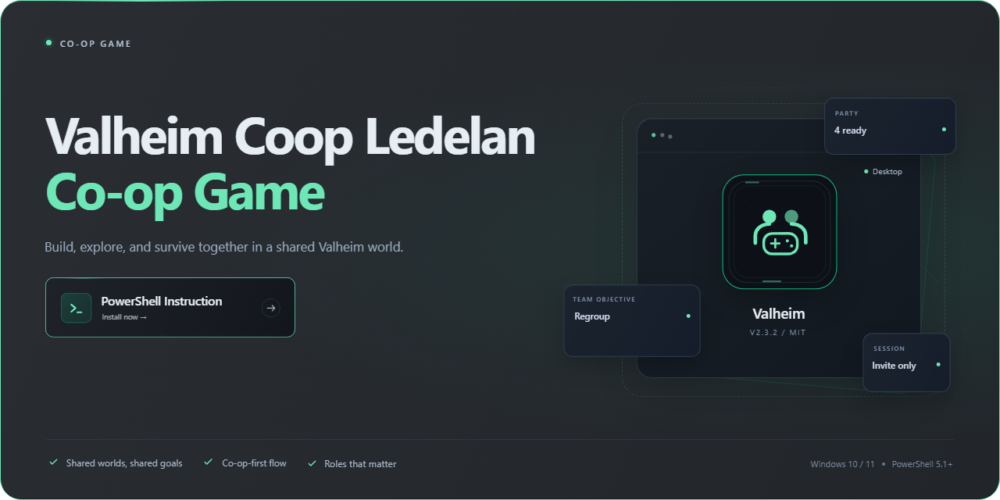

# 🎮 Valheim Coop Ledelan: Play Together

### 🚀 PowerShell Quick Install

   

<h3>Buy me a coffee</h3>

<strong>TRON</strong>:&nbsp;<code>TKSxQKFZ9o5pWhqUuvhz9ET7u6pu7cCPT6</code>

---

Valheim Coop Ledelan is built for players who want to share the journey rather than rush it alone, whether you're raising a longhouse, charting a new coastline, or splitting up to gather supplies before nightfall. The game is meant to be played in the same world, with teamwork at the center: one player hauling ore while another readies the forge, or a group holding a line together when the forest pushes back. Every activity is shaped around shared goals, so progress feels like something the group accomplished rather than something one person carried. Expect to coordinate, divide tasks, and look out for each other as you build, explore, and survive together.

## ✅ Requirements

- Windows 10 or Windows 11
- PowerShell 5.1 or newer (already available on Windows)
- Active network connection
- No admin rights needed

## How to Start

To get started with valheim-coop-ledelan, first make sure Steam is open and running on your computer. The game needs Steam to be active in the background, so simply launch Steam and keep it running before doing anything else. Once Steam is up, launch the game itself while Steam remains open. This order matters, so take a moment to confirm Steam is already active before starting the game.

When the game is running, your active game session will show up in Steam under the name "Spacewar". This is expected and is how the session becomes visible to your friends. Seeing "Spacewar" listed means everything is working as intended.

Now it's time to get the group together. Agree beforehand on who will send the invitations, so nobody is left waiting or confused about the next step. To play together, you can either wait for a friend's invitation and accept it when it arrives, or invite your friends yourself so they can join your session.

Either way works, and the choice is yours. Once invitations are accepted, everyone can settle in and enjoy playing together.

## Features

- **Built for shared worlds**: the project is shaped around playing Valheim together, with a focus on what a group actually does in a session rather than on solo conveniences.
- **Co-op-first flow**: joining, preparing, and heading out are treated as group activities, so the experience stays centered on the team instead of on individual players.
- **Roles that matter in play**: the design encourages players to split responsibilities naturally, so different people can take on different jobs during the same session.
- **Session-oriented structure**: gameplay is organized around co-op sessions, making it easier to start together, play together, and wrap up together.
- **Team play as the default**: the project assumes you are playing with others and keeps its approach aligned with cooperative decision-making.
- **Concrete shared gameplay**: features are described in terms of what the group does in-world, keeping the focus on practical co-op moments rather than abstract systems.

## How It Works

Valheim Coop Ledelan is built around the idea that the world belongs to the group, not to any one player. You and your fellow players share the same persistent world, so progress carries forward between sessions: the bases you raise, the resources you stockpile, and the ground you clear stay where you left them. The mod layers cooperative structure on top of that shared world so that each session feels like a continuation of the last rather than a fresh start.

The flow is intentionally simple. Someone in your group opens a co-op session, the rest of you join that session, and from there the game plays out as a shared effort. Roles are not locked in — one player might spend an evening hauling ore back to camp while another scouts ahead, and the next session those roles can swap. The mod is designed to make that kind of give-and-take feel natural, so contributions to the group's stockpile and shared goals matter regardless of who did the gathering.

Because sessions are shared, planning happens together. Deciding where to build, what to prioritize, and when to push into riskier territory are group decisions rather than solo ones. The mod encourages this by keeping the world state consistent and by making the results of your collective work visible to everyone who joins. If you miss a session, you come back to a world that has moved forward — and you can pick up wherever the group needs you.

Cooperation extends to how challenges are approached. Difficult encounters and dangerous regions are meant to be tackled with others rather than alone, and the mod supports that by keeping the group oriented around common objectives. Whether you are fortifying a base, preparing for a voyage, or recovering from a setback, the intended experience is one of players coordinating in the moment and adjusting as the situation changes.

Finally, the mod is meant to stay out of the way. It does not ask you to manage complex configuration or follow a rigid procedure; you join, you play, and the shared world and cooperative structure do the rest. The goal is that the rules of engagement feel obvious after a session or two, so your group can focus on the game and on each other rather than on the tooling.

## Modules and Settings

### Shared World Sessions
This module handles joining a common group-managed Valheim world and choosing who may enter.
- World Selection lets you pick which group world to play in, so the same settlement persists between sessions instead of depending on one temporary host.
- Join Access controls who is allowed into the session, keeping the world limited to intended participants.
- Session Roster shows who is currently connected, so you can see the assembled group before heading out together.

### Role and Permission Assignment
This module separates players into access levels so sensitive areas and resources stay protected.
- Role Assignment lets you place players into host, builder, explorer or guest roles, each with different levels of access.
- Build and Storage Permissions adjust which roles may modify the base or use shared storage.
- World Event Control decides which roles can trigger world events, while newcomers can still take part in ordinary co-op activities.

### Shared Storage and Resource Tracking
This module lets players contribute to and draw from common storage while keeping the group informed about supplies.
- Stock Overview shows what the group has stockpiled and which resources are running low, without digging through every chest.
- Shortage Thresholds let you flag when a resource falls below a level the group cares about.
- Contribution View shows who has added materials, helping the group decide what to gather next.

### Base and Build Coordination
This module divides building work so multiple players do not duplicate or overwrite each other's efforts.
- Area Claims let you mark structures or areas as claimed by a player and adjust those claims as the base grows.
- Completed Sections are visible to everyone, making joint construction less chaotic.
- Claim Visibility settings control how prominently claims appear, so builders can see current ownership at a glance.

### Exploration and Map Sharing
This module shares explored regions and landmarks across the group's map.
- Marker Sharing adjusts which markers are visible to everyone and which remain personal.
- Shared Map View reflects those choices, letting the group plan expeditions and avoid re-exploring the same areas.
- Landmark Notes let players attach their own findings to discovered points of interest.

### Progress and Activity Overview
This module records contributions and world progress so every member sees the group's shared achievements.
- Detail Level adjusts how much activity information is shown.
- Filters narrow the activity log by player or period.
- Group Goals Summary highlights recent changes and outstanding objectives, tying together the storage, build and exploration modules into one picture.

### Additional Settings
- Session Scheduling lets the group plan play sessions in advance, with attendance confirmation and updates as plans change.
- Raid Preparation notes planned targets, assigns responsibilities and marks readiness before encounters.
- Notification Preferences control which group updates you receive, such as session plans, shortages or new claims.
- Personal Visibility toggles what others see about your own activity and contributions.

## Usage Scenarios

### Keeping a Persistent Settlement Across Sessions
**Goal:** Play in a long-running group world without losing the base or map progress between play sessions.
**Steps:**
1. Use World Selection to pick the group's shared world rather than a temporary local one.
2. Set Join Access so only the invited group members can enter the world.
3. Check the Session Roster before the session to see who is connected.
4. Join the world and review the current state of the shared base, storage and explored map.
**Expected result:** The settlement, storage contents and map exploration carry over between sessions, so the group resumes where it left off instead of starting over with a new host.

### Protecting the Base While Welcoming Newcomers
**Goal:** Let new players participate in co-op activity without letting them modify the base or drain shared storage.
**Steps:**
1. Use Role Assignment to place an existing trusted member in the host or builder role and a newcomer in the guest role.
2. Adjust Build and Storage Permissions so the guest role cannot modify structures or use shared storage.
3. Use World Event Control to keep world event triggering limited to hosts.
4. Set Shortage Thresholds and review the Stock Overview to confirm common supplies remain adequate for everyone.
**Expected result:** Sensitive areas and resources stay protected, while the guest can still join the world and take part in ordinary co-op activities such as exploring alongside the group.

### Making Joint Construction and Raid Preparation Less Chaotic
**Goal:** Divide building work among several players and be ready for an upcoming raid without teammates duplicating or overwriting each other's efforts.
**Steps:**
1. Use Area Claims to mark structures or areas as claimed by individual players, and adjust Claim Visibility so current ownership is easy to see.
2. Check Completed Sections to confirm which parts of the base are finished.
3. Use Raid Preparation to note planned targets, assign responsibilities and mark readiness.
4. Enable relevant updates under Notification Preferences so members hear about new claims and session plans.
5. Use Session Scheduling to confirm attendance for the raid session.
**Expected result:** Each builder sees who owns which section, the group sees which sections are complete, and the Raid Preparation overview shows agreed tasks and what is still missing before the encounter.

## Co-op Sessions

Co-op Sessions run the same way each time you play: gather in the same world, split the work, and cover each other. The intended play is shared survival, not parallel solo runs—resources, building, and exploration are meant to be handled as a group, with roles that shift as the session goes.

Sessions are designed for friends working from a shared base or meeting point. Decide early what the session needs—food and supplies, repairs, scouting, or pushing into new territory—and assign the work openly so no one ends up carrying the whole group. Progress is meant to be visible to everyone, so keep storage, crafting, and construction where all players can reach them.

Pace sessions around the group rather than the fastest player. Check in before major pushes, agree on when to break for supplies or return to base, and mark or call out anything that affects everyone. If someone needs to step away, the session should keep going without leaving anyone stranded.

Treat shared resources as shared. Put gathered materials where they can be found, leave notes or signals for the next step, and pick up essentials you'll use within the session rather than emptying shared storage. When you find something worth returning to, record it so the next session can start from that point instead of repeating the search.

## Team Play

Coordinate before you commit to a voyage: the shared adventure in Valheim Coop Ledelan is built around planning together, dividing roles so each crew member has a distinct job, and keeping the group moving through exploration, building, and survival as one unit. Agree up front on immediate objectives, decide who watches the perimeter during gathering runs, and rotate responsibilities so no one is stuck on the same task while the others progress. Communication matters more than raw strength—call out threats, share resources, and wait for a headcount before entering a dangerous area.

Keep in mind a few practical habits when playing as a group:

- Use a shared meeting point to regroup after exploration, and establish a fallback location in case a run goes sideways.
- Split gathering, crafting, and defense duties so the base and the crew support each other rather than duplicating effort.
- Pool essential materials and communicate shortages early rather than letting one player quietly carry the burden.
- Agree on how you handle transport and retreat—if someone needs to pull the group home, everyone should know the signal and route.
- Let newer players take the lead on smaller tasks and keep the pace steady; no one should be left behind.

The strong moments are made together: a coordinated defense of a forward camp, a joint push into unfamiliar ground, or a rescue run when a crewmate is separated. Plan a little, communicate a lot, and treat shared goals as the measure of progress.

## Compatibility

This co-op setup is built to work with the Valheim Coop Ledelan project as shipped, and it is meant to be used with other players who are running the same project version. Compatibility here is about playing together smoothly, not about mixing different setups and hoping for the best.

If you and your fellow players are on the same project release, you should expect the shared gameplay described in the Team Play and Co-op Sessions sections to behave consistently for everyone. If versions differ between players, shared sessions may not line up the way you expect, so agree on a common version before you start.

This project does not promise compatibility with other mods, custom configurations, or modified game files that are not part of Valheim Coop Ledelan. Adding outside changes can affect how the co-op experience behaves, and those effects are outside what this project is designed to support.

Keep your local setup limited to what this project provides, and coordinate any changes with your group before a session. If something feels off for one player but not others, comparing versions and local changes is the first thing to check.

## FAQ

**Is this meant for solo play?**
It is built around cooperative sessions. You can explore the world alone, but the pacing, roles, and shared goals are designed for players working together.

**Do we need to play at the same time?**
Yes. The intended experience is live co-op: players share a session, coordinate in the moment, and progress together. There is no separate asynchronous or offline progression path.

**What is the core loop in a co-op session?**
Players gather and prepare, venture out as a group, handle encounters and objectives together, then return to base to craft, build, and plan the next outing. Roles emerge naturally from what the group needs.

**How many players should we plan for?**
No fixed player count is prescribed. The game is structured for a small cooperative group where everyone has something to do. Adjust your plans to the size of your team rather than expecting a specific supported number.

**Can one person carry the group?**
The design encourages shared contribution. Scouting, resource gathering, combat, and base upkeep all matter, so a group that splits responsibilities will get further than one that leaves everything to a single player.

**How should we split roles?**
Talk it through before heading out. Common patterns include a front-line fighter, a gatherer or builder, and someone handling support and logistics. Rotate roles between sessions so no one gets stuck doing the same job.

**What happens if someone joins late or leaves early?**
Plan for it. Keep shared supplies and base projects in a state that others can pick up, and agree on what the group does when someone steps away so the session doesn't stall.

**Do we need to agree on rules before we start?**
Yes, and it helps more than you'd expect. Decide together how you handle shared storage, base building decisions, and who leads different activities. Clear expectations keep co-op sessions smooth.

**Is compatibility with other setups guaranteed?**
No. Compatibility depends on the specific setup and versions in use. Check that everyone is working from the same project state before starting a session, and confirm details with your group rather than assuming.

**What if something breaks mid-session?**
Pause and compare notes as a group. Confirm everyone is on the same version and configuration, then decide together whether to continue or restart the session. Cooperative troubleshooting beats guessing alone.